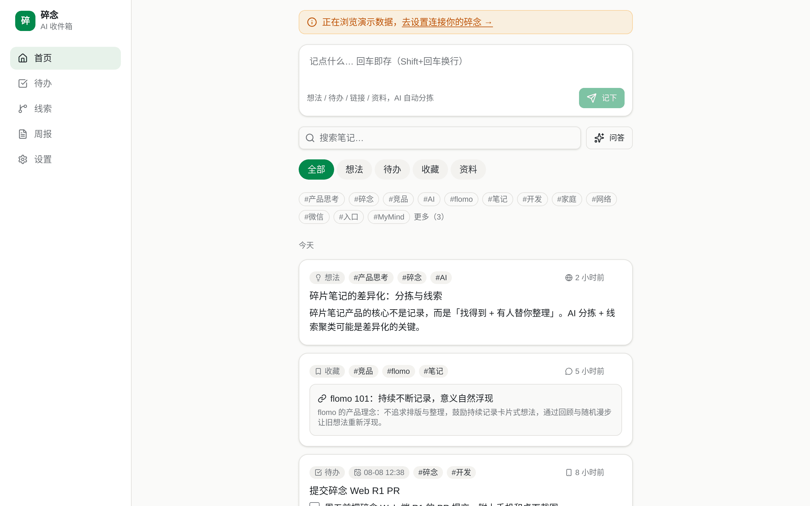
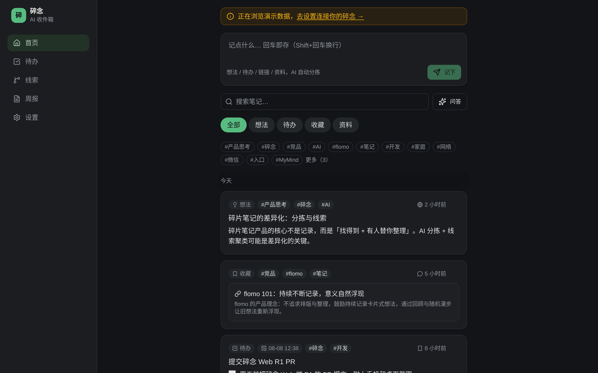
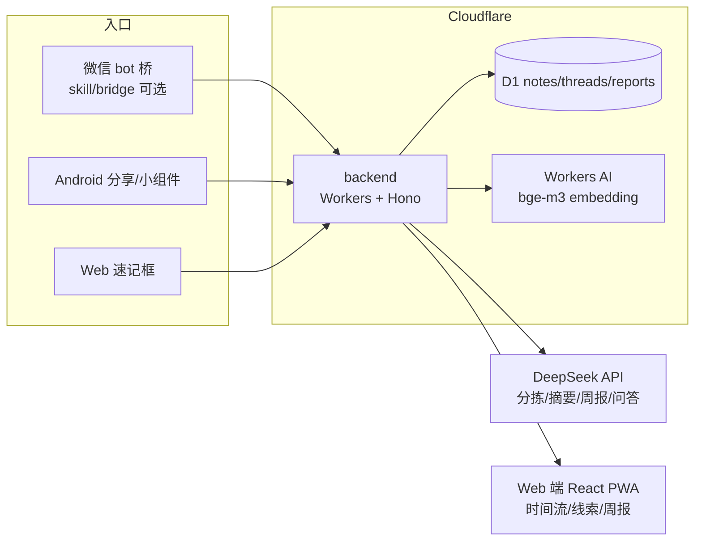
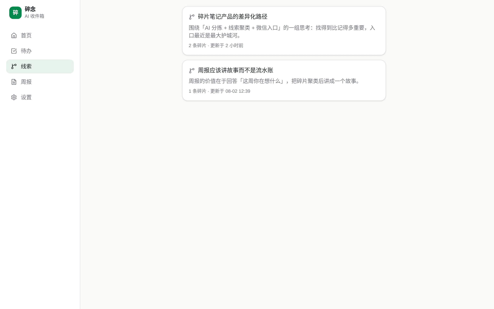
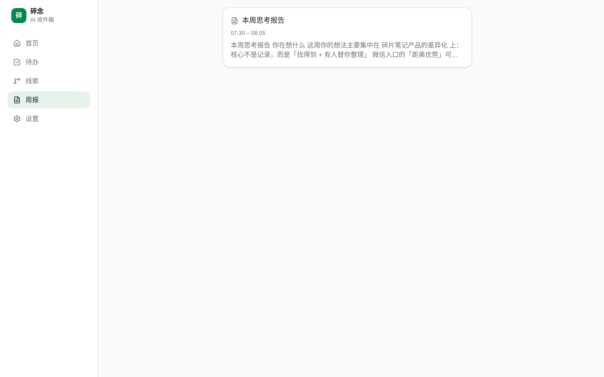
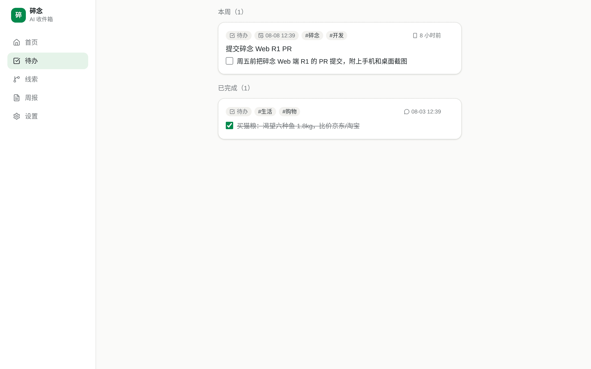

<div align="center">

# 碎念 Suinian

**开源可自部署的 AI 收件箱：微信里丢，AI 分拣、串线索、每周报告。**

想法、链接、待办、密码、文件——只管往微信（或 Web / Android）里丢，AI 帮你分拣归类、把散落数周的同题碎片串成思考线索，每周一告诉你「你最近在想什么」。

[在线体验（演示模式）](https://suinian.zalize.com) · [3 分钟自部署](docs/self-host.md) · [技术 SPEC](docs/SPEC.md)




</div>

## 为什么用碎念？

- **vs flomo**：flomo 靠你自己回顾；碎念用 AI 自动分拣（想法/待办/收藏/资料）、自动打标签，还把碎片串成「思考线索」。
- **vs Cubox**：Cubox 是稍后读收藏夹；碎念什么都能收（文字/链接/语音/图片/密码），敏感内容 AES-256-GCM 加密，且**开源可自部署**，数据在你自己的 Cloudflare 账号里。
- **微信即入口**：不用装新 App，给 bot 发消息就是记录，`?` 开头就是问答检索（微信入口可选，纯 Web/API 也完整可用）。

## 架构



## Quick Start（TL;DR，约 3 分钟）

需要：Cloudflare 账号 + [DeepSeek API Key](https://platform.deepseek.com/)。完整步骤见 [docs/self-host.md](docs/self-host.md)。

```bash
git clone https://github.com/wookat/suinian.git && cd suinian

# 1) 后端：D1 + Workers
cd backend && npm install
npx wrangler d1 create suinian          # 把返回的 database_id 填入 wrangler.toml
npx wrangler d1 migrations apply suinian --remote
npx wrangler secret put DEEPSEEK_API_KEY
openssl rand -base64 32 | npx wrangler secret put SUINIAN_ENC_KEY
npx wrangler deploy                     # 先删掉/改掉 wrangler.toml 里的 routes 自定义域
npx wrangler d1 execute suinian --remote --command \
  "INSERT INTO users (id,name,api_token) VALUES ('u_me','me','$(openssl rand -hex 24)')"

# 2) Web 端：Cloudflare Pages
cd ../web && npm install && npm run build
npx wrangler pages deploy dist --project-name suinian

# 3) 打开 Web 端 → 设置页填 API 地址与 token，开始丢碎片
```

微信入口（可选）：见 [skill/README.md](skill/README.md)，海外用户可跳过，Web/API 即完整体验。

## 子目录导览

| 目录 | 内容 | 技术栈 |
|---|---|---|
| [`backend/`](backend/) | notes API、DeepSeek 分拣管线、线索聚类、周报、加密 | Cloudflare Workers + Hono + D1 |
| [`web/`](web/) | 时间流 / 待办 / 线索 / 周报视图，PWA | React 19 + Vite + Tailwind v4 + shadcn/ui |
| [`skill/`](skill/) | 微信 bot 桥（独立进程）+ OpenClaw skill | Node.js / Docker |
| [`android/`](android/) | 分享接收、小组件、原生查看端 | Kotlin + Jetpack Compose |
| [`docs/`](docs/) | [自部署指南](docs/self-host.md)、[SPEC](docs/SPEC.md)、[产品方案](docs/product-plan.md)、[竞品调研](docs/research-competitors.md) | — |

## 功能一览

**时间流**：速记框回车即存，AI 自动分拣角标 + 标签 + 链接卡片；分类/标签/关键词筛选，问答模式自然语言检索。

**思考线索**（灵魂功能）：把分散数周的同题碎片自动聚成线索（embedding 相似度 + AI 确认）。



**周报**：每周一自动生成「本周你在想什么」思考报告，微信推送。



**待办**：AI 识别待办与截止时间，未完成/已完成分组，一键勾选。



**Android**：任意 App「分享 → 碎念」、桌面小组件速记、离线队列自动重试（见 [android/README.md](android/README.md)）。

## 贡献与许可

欢迎 Issue / PR，见 [CONTRIBUTING.md](CONTRIBUTING.md)。代码以 [MIT License](LICENSE) 开源。
