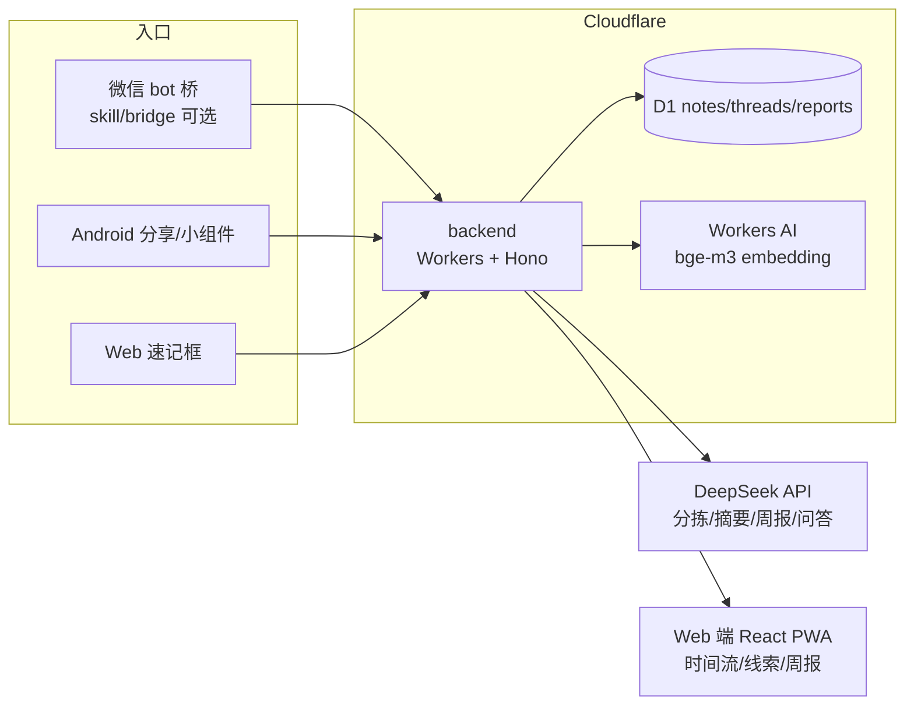

<div align="center">

# 碎念 Suinian

**像发消息一样记录一切：什么都能丢，AI 自动分拣、串线索、每周报告。开源可自部署。**

*An open-source, self-hostable AI inbox: dump anything into WeChat (or Web/API), AI sorts it, threads recurring thoughts, and reports weekly.* — [English README](README.en.md)

[](LICENSE)
[](https://workers.cloudflare.com/)
[](CONTRIBUTING.md)

想法、链接、待办、密码、文件——只管往微信（或 Web / Android / 浏览器剪藏 / MCP）里丢，AI 帮你分拣归类、把散落数周的同题碎片串成思考线索，每周一告诉你「你最近在想什么」。

[在线体验（演示模式）](https://suinian.zalize.com) · [3 分钟自部署](docs/self-host.md) · [接入 Claude / Cursor（MCP）](docs/mcp.md) · [技术 SPEC](docs/SPEC.md)


</div>

## 为什么用碎念？

- **vs flomo**：flomo 靠你自己回顾；碎念用 AI 自动分拣（想法/待办/收藏/资料）、自动打标签，还把碎片串成「思考线索」。
- **vs flomo Agent（MAX）**：flomo Agent 也住在微信里，但锁在 MAX 付费订阅后，记录仍靠你自己打标签（Agent 是"聊出来再写回"），没有产品化的线索视图；碎念免费开源，每条自动分拣，线索自动聚成视图，数据在你自己账号里。
- **vs Cubox**：Cubox 是稍后读收藏夹；碎念什么都能收（文字/链接/语音/图片/密码），敏感内容 AES-256-GCM 加密，且**开源可自部署**，数据在你自己的 Cloudflare 账号里。
- **微信即入口**：不用装新 App，给 bot 发消息就是记录，`?` 开头就是问答检索（微信入口可选，纯 Web/API 也完整可用）。

| 能力 | 碎念 | flomo Agent（MAX） | OmniBox | just-note | mymind / Mem |
|---|---|---|---|---|---|
| 微信零摩擦输入 | ✅ bridge/skill | ✅ 付费墙 | ✅ ClawBot | ✅ | ❌ |
| AI 自动四类分拣 | ✅ | ❌（聊天写回） | ❌ | ✅（9 类 md） | 部分（magic 分类） |
| **自动思考线索聚类** | ✅ | ⚠️ 仅被动提醒 | ❌ | ❌ | ❌ |
| 周报 | ✅ | ❌（可让 Agent 定时） | ❌ | ✅（md） | ⚠️ API 可自建 |
| 敏感内容加密（AES-256-GCM） | ✅ | 密码锁（非 e2e） | ❌ | ❌ | ❌ |
| MCP（Claude/Cursor/Codex 直连） | ✅ 远程+stdio | ❌ | ⚠️ skill | ⚠️ skill | ⚠️ API 自建 |
| 开源自部署 | ✅ | ❌ | ❌ | ⚠️ 仅 skill | ❌ |
| 免费 | ✅ | Agent 要 MAX | 转向收费 | ✅ | 订阅 |

## 从 Cubox / flomo 一键搬家

Cubox 已官宣 **2027-05 停止速记/文件功能**，正在找新家？碎念三步接收你的全部数据：旧工具导出（Cubox CSV / flomo HTML / Markdown / 纯文本）→ 设置页「导入数据」上传 → 原创建时间与标签全部保留，AI 自动补分拣、串线索。迁移完成后每天还有「今日回顾」把老笔记重新翻出来。

👉 [完整迁移指南](docs/migrate-from-cubox.md)

## 哪里都能丢进来

| 入口 | 一句话 | 去哪里 |
|---|---|---|
| 微信公众号 | 关注 + 发绑定码即接入，发消息就是记录（普通用户零门槛） | [docs/wechat-integration.md](docs/wechat-integration.md) |
| 微信 bot（自托管） | 个人微信 bridge，`?` 开头即问答（极客自部署） | [skill/](skill/) |
| 浏览器剪藏扩展 | 网页选中右键一键收进碎念 | [extension/](extension/) |
| Android | 系统分享面板 + 桌面小组件速记 | [android/](android/) |
| Web · PWA | 手机桌面装成 App，离线可用 | [suinian.zalize.com](https://suinian.zalize.com) |
| MCP | Claude Desktop / Claude Code / Cursor / Codex 里直接读写碎念 | [docs/mcp.md](docs/mcp.md) |

## 架构



## Quick Start（3 步部署）

需要：[Cloudflare 账号](https://dash.cloudflare.com/)（免费版即可，AI 用 Workers AI 无需外部 key）+ Node.js ≥ 20。

```bash
# 1) clone 并登录 Cloudflare
git clone https://github.com/wookat/suinian.git && cd suinian
npx wrangler login

# 2) 一键部署（交互式建 D1/R2、migrations、secrets、部署 Worker + Pages、配 CORS）
bash scripts/setup.sh

# 3) 打开输出的 Web 地址 → 引导里「注册新账号」，开始丢碎片
```

手动步骤、常见报错排查见 [docs/self-host.md](docs/self-host.md)。微信入口（可选）：见 [skill/README.md](skill/README.md)，海外用户可跳过，Web/API 即完整体验。

本地开发（不部署、无 key 也能跑）：

```bash
cd backend && npm install && cp .dev.vars.example .dev.vars && npm run dev:init && npm run dev
cd web && npm install && cp .env.example .env.local && npm run dev   # 另开终端
```

## 子目录导览

| 目录 | 内容 | 技术栈 |
|---|---|---|
| [`backend/`](backend/) | notes API、DeepSeek 分拣管线、线索聚类、周报、加密 | Cloudflare Workers + Hono + D1 |
| [`web/`](web/) | 时间流 / 待办 / 线索 / 周报视图，PWA | React 19 + Vite + Tailwind v4 + shadcn/ui |
| [`extension/`](extension/) | 浏览器剪藏扩展：一键存页 / 划词保存 / 备注标签 | WXT + Manifest V3 + Readability |
| [`skill/`](skill/) | 微信 bot 桥（独立进程）+ OpenClaw skill | Node.js / Docker |
| [`android/`](android/) | 分享接收、小组件、原生查看端 | Kotlin + Jetpack Compose |
| [`docs/`](docs/) | [自部署指南](docs/self-host.md)、[SPEC](docs/SPEC.md)、[产品方案](docs/product-plan.md)、[竞品调研](docs/research-competitors.md) | — |

## 功能一览

**时间流**：速记框回车即存，AI 自动分拣角标 + 标签 + 链接卡片；分类/标签/关键词筛选，问答模式自然语言检索。

**思考线索**（灵魂功能）：把分散数周的同题碎片自动聚成线索（embedding 相似度 + AI 确认）。


**周报**：每周一自动生成「本周你在想什么」思考报告，微信推送。


**待办**：AI 识别待办与截止时间，未完成/已完成分组，一键勾选。


**Android**：任意 App「分享 → 碎念」、桌面小组件速记、离线队列自动重试（见 [android/README.md](android/README.md)）。

**API / Agent 接入**：REST API 全量文档化（[backend/README.md](backend/README.md)），可作为个人记忆源接入 Claude / OpenClaw / 任意 agent，见 [docs/integrations.md](docs/integrations.md)。

**从 Cubox / flomo 迁移**：设置页「导入数据」一键导入 Cubox（CSV / 书签 HTML / txt）、flomo（HTML）及通用 Markdown / 纯文本导出文件：保留原创建时间与标签、链接走既有抓取管线、重复自动跳过，AI 分拣/线索/图谱后台陆续补齐。详见 [docs/import.md](docs/import.md)。

## 贡献与许可

欢迎 Issue / PR，见 [CONTRIBUTING.md](CONTRIBUTING.md)。代码以 [MIT License](LICENSE) 开源。
