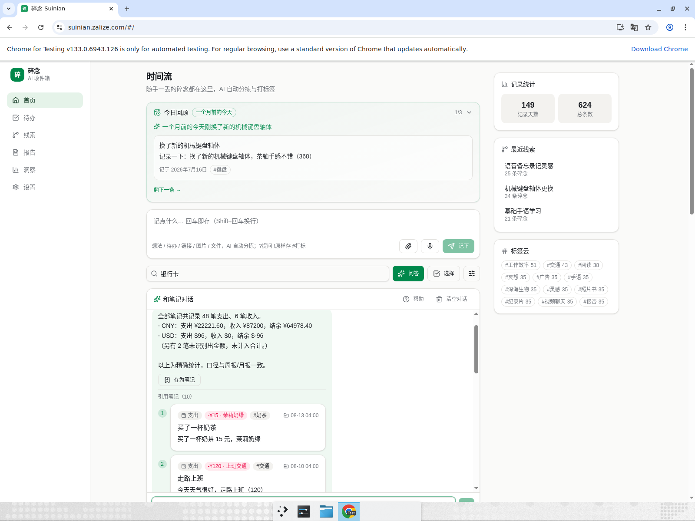
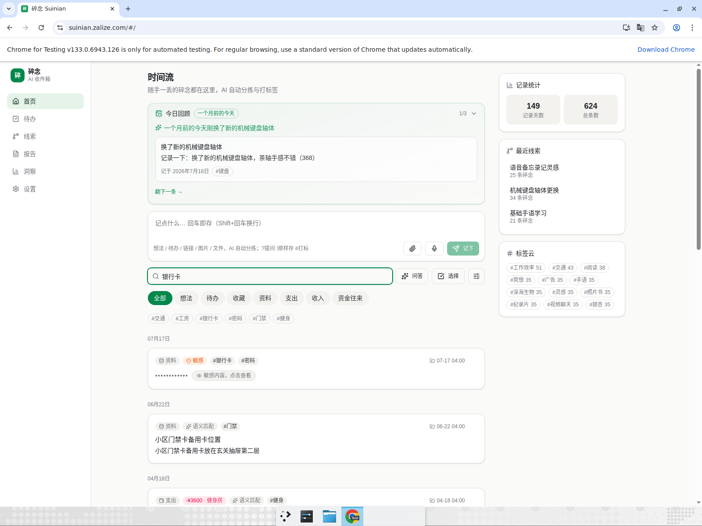
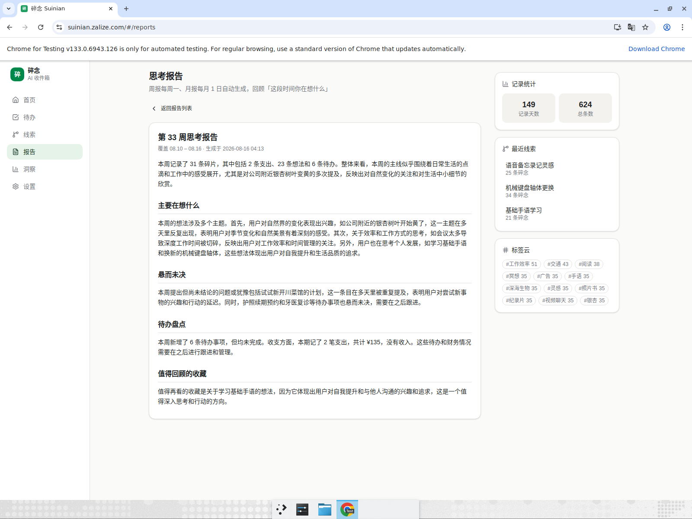

# R149 独立审查报告（只审不改）

- 审查对象：生产 https://suinian.zalize.com（API https://suinian-api.zalize.com），仓库 main @ 393a333（R148 #170 之后）。
- 审查方式：独立 QA 账号 `[QA-R149]-main`（u_3d44cba373c9），导入 620 条与 R147 不同主题的重载语料（620 条生成语料 + 附件/导入笔记，最终 624 条、30 条线索、3 条敏感笔记、48 笔支出/6 笔收入），生产 API 实测 + D1 直查 + 源码静态审查 + Web UI 录屏走查。所有结论均按【生产实测】【D1 实查】【源码走读】【推断】标注口径。
- QA 自清：测毕 `DELETE /api/auth/me` 注销；D1 复核 users 仅剩 `u_boss / Thomas`，notes/threads/daily_reviews/weekly_reports/entities/edges/thread_jobs/thread_backfill/user_preferences/push_subscriptions/wecom_kf_bindings 该用户行数均为 0，note_embeddings/attachments 无孤儿行【D1 实查】。审查期间产生的临时 eval 账号与恢复码测试账号也已删除并 D1 复核。

## 结论速览

- **P0：无。** 「什么都能丢 → AI 整理 → 可靠找回」三环节在重载语料下均可完整走通。
- R148 复核通过：积压期时间流可用、换措辞 15 问 14/15 精确或诚实 fail-closed、误路由压测 30/30 零误入。
- 意图路由架构健康度：**良好偏警惕**——fail-closed 纪律执行到位（压测零误入），但规则面持续膨胀已出现第一例「规则互相劫持」实锤（P1-1），碎片化风险从推断变为观测事实。
- 核心 eval 78/81（96%），holdout 20/21，较 R148 的 77/81 持平略升。

---

## 1. R148 复核（重点 1）

### 1.1 积压期时间流可用性【生产实测】
- 620 条语料经 `/api/import` 一次性导入制造积压（pending 峰值 600+），积压消化期间独立采样 `GET /api/notes?limit=30`：约 146 个样本中 144 个 HTTP 200，有效样本均值约 252ms，最大 7497ms（单次尖峰），1 个网络层失败（curl 000，未复现）。
- 未复现 R147 P1-1 的 60s 超时；R148 的「先序列化响应、retriage 改 waitUntil 后置」防御在重载期有效。积压最终清零，全部笔记完成分拣（UI + API 双检 0 条「分拣中」残留）。

### 1.2 精确路由 15 问变体（换措辞防过拟合）【生产实测 + D1 对账】
15 问全部为重新构造的措辞变体，逐条与 D1 直查对账：

| # | 问题 | 路由 | 结果 |
|---|---|---|---|
| E01 | 哪笔开销金额最大 | finance_extreme | ✓ ¥12999 相机，多币种分别比较 |
| E02 | 我花钱最狠的一次花了多少 | finance_subset fail-closed | 诚实拒算（见 P2-1：变体未进极值路由） |
| E03 | 金额最小的一笔开支是啥 | finance_extreme | ✓ ¥5 停车费 |
| E04 | 奶茶买过几次 | topic_count | ✓ 18 条 = D1 LIKE 计数 |
| E05 | 我提到过多少次游泳 | topic_count | ✓ 10 条 = D1 LIKE 计数（语料含 2 条不含字面「游泳」的泳镜/泳姿笔记，答案明示「关键词匹配口径」，诚实） |
| E06 | 水电费一共交了多少钱 | 普通召回（LLM） | 答案 1069.6 元正确，但走了 LLM 心算路径（见 P2-2） |
| E07 | 奶茶总共花了多少 | finance_subset | ✓ ¥279 / 18 笔 = 语料真值 |
| E08 | 我一共花了多少钱 | finance_aggregate | ✓ 支出 ¥22221.60（45 笔 CNY）+ $96 + 2 笔未识别 = D1 对账一致 |
| E09 | 收入加起来一共有多少 | finance_aggregate | ✓ 收入 ¥87200 = 真值 |
| E10 | 到现在为止我记了多少条笔记 | count_aggregate | ✓ 624 条，分类分布与 D1 一致 |
| E11 | 待办笔记有几条 | count_aggregate（scoped） | ✓ 48 条 = D1 |
| E12 | 我最早的一条笔记是什么时候写的 | extreme_aggregate | ✓ 2026-03-19 |
| E13 | 关于阳台种菜的笔记都有哪些 | enum_topic | ✓ 10 条 = D1 LIKE（tags 命中） |
| E14 | 上个月都记了些什么 | 普通召回 | ✗ 应走时间窗枚举，被「什」劫持（见 P1-1） |
| E15 | （合计后追问）包括 Notion 订阅吗→带限定合计 | finance fail-closed | ✓ 诚实拒算并给全量口径 |

结论：14/15 精确或诚实 fail-closed，无一例「给出错误数字」——R148 修复无过拟合迹象；E14 暴露一个真实路由 bug（P1-1）。

## 2. 意图路由架构周期审查（重点 2）

### 2.1 误路由压测：30 个非统计问题【生产实测】
30 问覆盖细节回忆、是非、原因、内容引用、跨笔记综合等非统计意图，逐条检查响应元数据：**0/30 误入精确路由**（无任何 finance_*/count_*/extreme_*/enum_* 标志），全部走普通召回。fail-closed 纪律在压测下成立。

### 2.2 静态审查与健康度结论【源码走读 + 生产实测】
- 现状：`backend/src/ask.ts`（940 行）集中承载 7 个精确路由家族（财务合计/子集求和/极值、计数/主题计数、极值查询、时间窗枚举、主题枚举）+ 澄清追问 + 受约束 LLM 意图分类兜底。路由判定全部为正则规则，家族间靠「先后顺序 + 互斥前置检查」（如 topicEnumIntent 先排除 FINANCE_WORD/extreme/count）协调。
- 正面：①单文件内聚、路由与执行分离、每家族有独立 fail-closed 文案；②LLM 意图分类只在规则全部未命中时调用且参数严格校验（主题词必须出现在原问题中），校验不过回落普通召回——这是对「规则化失控」的关键护栏；③压测零误入证明「宁可漏进不可错进」的取向落地了。
- 负面（碎片化的第一例实锤）：**P1-1 就是规则间隙**——`TOPIC_ENUM_RES[0]` 的贪婪捕获把「都记了些什么」的「什」当主题词，抢在 enumListIntent 之前把时间窗枚举劫持掉。这不是孤例模式：7 个家族的正则各自维护「动词表、量词表、剥离词表」，新增家族时的互斥关系靠人工记忆，R148 刚加的三个家族与 R130 的主题枚举之间没有回归测试互锁（本例恰是新老规则交界）。
- **健康度结论：良好偏警惕。** 当前不需要推倒重来（LLM 意图分类兜底 + fail-closed 已是正确骨架），但建议：①任何新路由家族合入前跑一套「跨家族互斥回归集」（把历轮 30 问忠实性 + 30 问误路由固化为 eval 断言，含各家族边界措辞）；②主题词提取加最小长度/泛指词校验（「什」「啥」这类单字疑问词不应成为主题）；③若下一轮再出现家族间劫持，应考虑把「路由判定」统一收敛为单一分类器（规则只做参数抽取），而不是继续加第 8 个正则家族。

## 3. R141–R148 防漂移抽测 10 项 + 核心 eval（重点 3）

| # | 抽测项（来源轮次） | 方式 | 结果 |
|---|---|---|---|
| 1 | 恢复码找回：错误码统一 401、成功后改密+轮换 token+换发新码、旧码失效（R144） | 生产实测（临时账号） | ✓ 全部符合 |
| 2 | flomo zip 导入：memo 解析、图片重写【图片：名】并入 R2 附件（R142） | 生产实测（合成 zip） | ✓ 文字+图片标记+附件均正确 |
| 3 | 附件元数据只透出 id/name/mime/size，不露 r2_key（R144） | 生产实测 | ✓ |
| 4 | 音频/图片 ingest + MIME 扩展名兜底（R146/R148） | 生产实测（wav/png 直传） | ✓ 转写与 OCR 管线走通、类型正确 |
| 5 | 敏感笔记：导出脱敏 `[已加密内容]`、问答不进召回但给解锁提示（R110+） | 生产实测 | ✓ 导出 6 处占位=3 条敏感笔记；问答诚实拒引并提示 |
| 6 | MCP 输出脱敏 `[敏感内容已脱敏]` + 未授权 401（R145） | 生产实测（/mcp JSON-RPC） | ✓ search_notes 返回敏感笔记全遮罩 |
| 7 | 财务澄清追问（R130）带历史「包括 X 吗」 | 生产实测 | ✓ fail-closed 口径诚实 |
| 8 | 时间流积压期可用性（R148） | 生产实测 | ✓ 见 1.1 |
| 9 | 主题枚举/主题计数精确路由（R130/R148） | 生产实测 + D1 对账 | ✓ E04/E05/E13 |
| 10 | 导入 source 参数校验/超限报错文案（R130） | 生产实测 | ✓ query 传 source 被明确拒绝并给出正确指引 |

核心 eval【本地实跑，生产 API】：**78/81（96%）**，holdout 20/21，较 R148 基线 77/81 持平略升。3 个失败均为普通召回的回答质量问题（q12 跨片段综合混入无关决定、q31 依据类回答引用不全、q52 演化类问题只给 2 条直接命中），无精确路由失败，无漂移迹象。

## 4. 洞察/回顾/周报内容质量复审（重点 4）【生产实测 + D1 对账】

- **数字全部精确**：周报「本周 31 条（2 支出/23 想法/6 待办）、支出 ¥135」与 D1 周窗口逐分类计数完全一致；月报「76 条（1 收藏/5 支出/59 想法/11 待办）、支出 ¥188」同样与 D1 一致。R147 曾指出的数字口径问题无复发。
- 今日回顾点评得体（「一个月前的今天刚换了新的机械键盘轴体」「坚持读书半小时已经273天了」——后者对语料中「第 N 天（273）」的解读忠实）。
- 措辞问题（P2-3）：周报/月报正文多处以第三人称「用户」自称（「表明用户对季节变化…」），与产品「你的第二大脑」的第一/第二人称语感割裂；月报对 ¥188 月支出评「有不少开支…需要注意财务平衡」，金额与评语不匹配，重载语料下评语模板痕迹显现。
- 线索页 30 条线索整体聚类合理（银杏变黄、weeknotes-bot、阳台种菜等主题干净），但存在 6 组标题重复的分裂线索（P1-3）和一条 67 条笔记的「冥想和视频聊天」双主题混聚大线索（P2-4）。

## 5. 设计质疑：2 个未审流程深挖（重点 5）

### 5.1 MCP 通道（`backend/src/mcp.ts`，历轮未深挖）【源码走读 + 生产实测】
- 现设计：`/mcp` Streamable HTTP，每请求用调用者 Bearer token 构建无状态 server，10 个工具全部内部转调既有 REST 路由（`app.request` 带原 token），鉴权/校验/限流/用户隔离全部继承；敏感笔记双层脱敏（`redactNote`）+ 未分拣笔记保守脱敏（`redactPendingNote`，防「先泄后判敏」）。生产验证：无 token 401、initialize 正常、search_notes 对敏感笔记 content/title/tags 全遮罩。
- 质疑「是否最适合」：**是，且是全仓库耦合控制最好的模块之一**——零直接 SQL、零业务复制，新 REST 能力自动可暴露；「未分拣即脱敏」的保守取向对第三方 AI 客户端场景正确。两点改进建议（不定级）：①`save_note` 指定 category 时是先 POST 再 PATCH 两步，PATCH 失败会静默返回未改类目的笔记（`patched.status===200` 才更新，失败无提示），建议失败时在返回中注明「分类未生效」；②MCP 与 REST 共用同一把全权 token，第三方客户端拿到的 token 同时能删号/导出全量数据，长期可考虑只读/受限 scope token（如无必要勿增实体——当前单用户自用场景可接受，多用户开放时再做）。

### 5.2 企业微信客服通道（`backend/src/wecom-kf.ts`，历轮未深挖）【源码走读】
- 现设计：加密回调验签→后台 `waitUntil` 拉 sync_msg（游标存 D1）→逐条 ingest（文字/链接/图片/语音/文件/小程序）→48h 窗内回执「已存 ✓」；绑定码复用公众号表、解绑一条消息完成；未配置 secrets 时整个端点 404。整体与公众号通道共用 crypto/绑定基建，实体克制。
- 质疑「是否最适合」：主体是，但发现一个与核心主线相关的可靠性缺口——**D-1（设计建议，倾向 P2）：sync 游标先行持久化 = at-most-once**。`syncKfMessages` 每拉一页就把 next_cursor 写入 D1，然后才逐条 ingest；且整个 sync+ingest 被 `PIPELINE_TIMEOUT_MS`（60s）截断。若 Worker 在「游标已推进、消息未入库」之间超时/崩溃（大批量转发+每条走 LLM 分拣时 60s 并不宽裕），这批转发内容会**静默丢失**——用户收不到「已存 ✓」回执是唯一线索，与注释宣称的 exactly-once 不符，直接触碰「什么都能丢」的可靠性承诺。建议：先逐条 ingest 成功后再推进游标（sync_msg 游标天然支持重放，代价只是偶发重复，可用 msgid 幂等去重），或至少把「已拉取未入库」的 msgid 落一张待处理表。另两点小建议：未绑定用户发来的内容在提示绑定后即丢弃（绑定成功后不补收），可在提示文案中明示「绑定前发送的内容不会保存」；corp access_token 明文存 D1 state 表（短时效，可接受，注明即可）。

## 6. Web UI 视觉走查【生产实测，录屏 + 截图】

时间流首屏 <2s；语音笔记原生播放控件 + 转写失败重试、图片缩略图、敏感遮罩/点击解锁/再遮罩均正常；今日回顾翻页正常；周报/月报渲染良好且「同周期重复生成覆盖」提示清晰；设置页 flomo 导入/备份/危险操作区块完备。视觉问题见 P2-5/P2-6/P2-7。

## 问题分级汇总

| 级别 | 问题 | 影响核心主线 | 证据口径 |
|---|---|---|---|
| P1-1 | 「…些什么」措辞被 `TOPIC_ENUM_RES[0]` 贪婪捕获出单字主题「什」，抢先劫持时间窗枚举路由（`enumListIntent` 命中但被 `if (enumTopic) enumList = false` 关闭），「上个月都记了些什么」落回普通召回，答案薄且混入本月内容；「上周都记了什么」（无「些」）不受影响 | 部分（找回环节：时间窗枚举是 R123 明确修复过的能力，此措辞下回退） | 生产实测 E14 + 本地 tsx 复现 `topicEnumIntent('上个月都记了些什么？')==='什'`【源码级根因】 |
| P1-2 | 时间流空态文案称「敏感笔记正文已加密存储，不参与关键词搜索」，但 `GET /api/notes?q=密码` 实际命中敏感笔记且响应含明文正文（UI 侧有遮罩；问答路由的敏感提示也明示「可到时间流搜索…解锁查看」）。行为与文案二者必有其一错：要么改文案，要么真的把敏感正文从搜索索引剔除 | 否（持有者 token 场景，无越权泄露） | 生产实测 API + `web/src/pages/timeline.tsx:1078` 文案 |
| P1-3 | 30 条线索中 6 组标题重复分裂（语音备忘录记灵感/基础手语学习/银杏变黄/地铁广告词/会议深度工作/加班效率），同主题被拆进两条线索 | 部分（洞察环节可信度） | 生产实测 /api/threads + 截图 assets/r149-threads-duplicates.png |
| P2-1 | 「花钱最狠的一次」未进 finance_extreme（诚实 fail-closed，未错答），极值措辞表可补 | 否 | 生产实测 E02 |
| P2-2 | 「水电费一共交了多少钱」因「交」不在财务动词表未进子集求和，走 LLM 心算（本例恰好算对，路径有风险） | 部分（重载下 LLM 心算不可靠） | 生产实测 E06 |
| P2-3 | 周报/月报第三人称「用户」措辞 + 小额支出配「需要注意财务平衡」评语，模板痕迹 | 否 | 生产实测报告原文 |
| P2-4 | 「冥想和视频聊天」67 条双主题混聚大线索 | 否 | 生产实测 |
| P2-5 | 线索关系图节点标签重叠不可读（assets/r149-graph-label-overlap.png） | 否 | 生产实测截图 |
| P2-6 | 图片笔记正文渲染字面 `<无>` 占位（assets/r149-image-note-none.png） | 否 | 生产实测截图 |
| P2-7 | 标签管理 100+ 单条长尾标签无折叠，滚动噪音 | 否 | 生产实测截图 |
| P2-8 | 问答引用洪泛：部分普通召回答案尾部堆 20+ 个 [n] 引用角标（M25/M30） | 否 | 生产实测 |
| D-1 | 企业微信客服 sync 游标先行持久化 = at-most-once，超时/崩溃窗口内转发内容静默丢失；建议 ingest 成功后再推进游标 + msgid 幂等 | 是（潜在，「什么都能丢」可靠性） | 源码走读（未生产复现，通道未配置无法实测） |
| D-2 | MCP save_note 的 category PATCH 失败静默降级；MCP 共用全权 token 无只读 scope | 否 | 源码走读 + 生产实测 |
| D-3 | 微信绑定卡未配置时整卡隐藏，用户无从得知通道存在；建议留一行「暂未开通」 | 否 | 生产实测 + 源码 |
| D-4 | 建议把历轮 30 问忠实性 + 30 问误路由固化为跨家族互斥回归集，作为新路由家族合入门槛 | —（工程护栏） | 本轮 2.2 结论 |

## 三环节评分（10 分制）

- **记录「什么都能丢」：9** — 文字/链接/图片/语音/文件/flomo 迁移/MCP 全通道走通，积压期时间流稳定；扣分：`<无>` 占位观感、微信客服通道的 D-1 潜在丢失窗口。
- **找回「可靠找回」：8.5** — 精确路由对账全对、误路由零误入、eval 96%、敏感/脱敏纪律严；扣分：P1-1 路由劫持、P2-2 心算路径、普通召回覆盖偏薄（q12/q31/q52）。
- **整理「AI 整理」：7.5** — 分拣分类与报告数字精确、今日回顾得体；扣分：P1-3 线索分裂、P2-3 报告措辞模板化、P2-4 混聚。

## 附录：证据清单

- 生产 QA 账号：`[QA-R149]-main`（624 条笔记、30 线索、周报+月报、附件/敏感/导入笔记），测毕注销并 D1 逐表复核清零。
- 录屏：Web 生产 UI 走查（时间流/附件播放/敏感解锁/问一问 2 问/线索列表与 67 条大线索/周月报/今日回顾/设置页，带结构化注释；含一次本机 Chrome 崩溃后经设置页 token 重连的环境插曲，非产品问题）。
- 截图：docs/assets/r149-*.png 共 6 张（精确合计、敏感遮罩、周报、线索重复、图谱标签重叠、`<无>` 占位）；完整 20 张随会话附件。
- 数据对账：D1 直查（Cloudflare API）与 15 问精确路由逐条对账；周/月报分类计数与金额对账。
- 本地验证：docs-only 变更；核心 eval 与路由复现脚本在会话侧执行（tsx 复现 P1-1 根因）。
